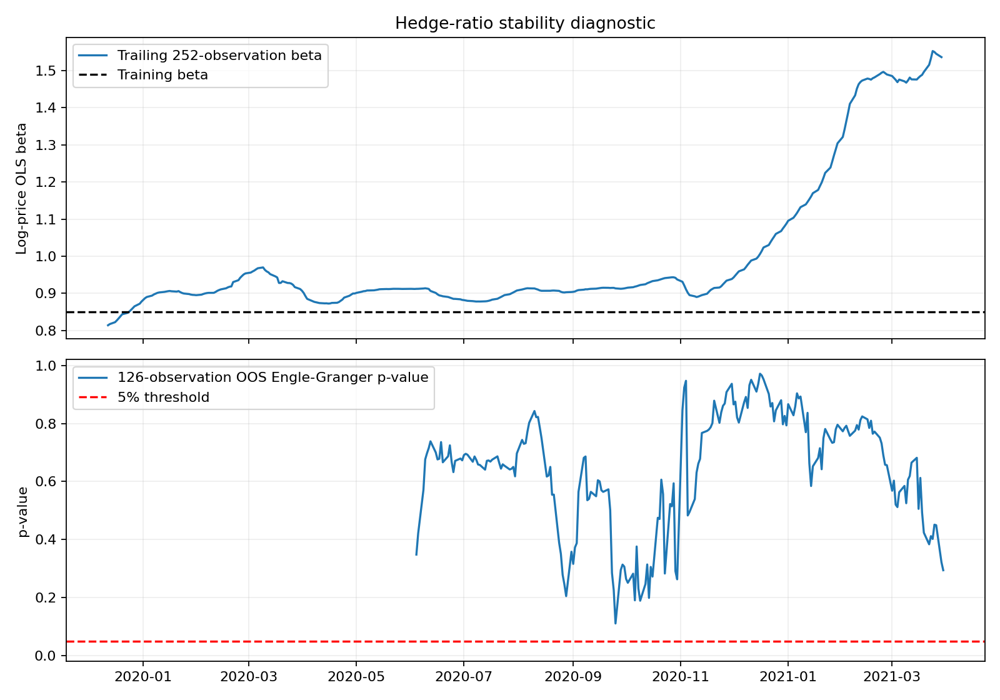
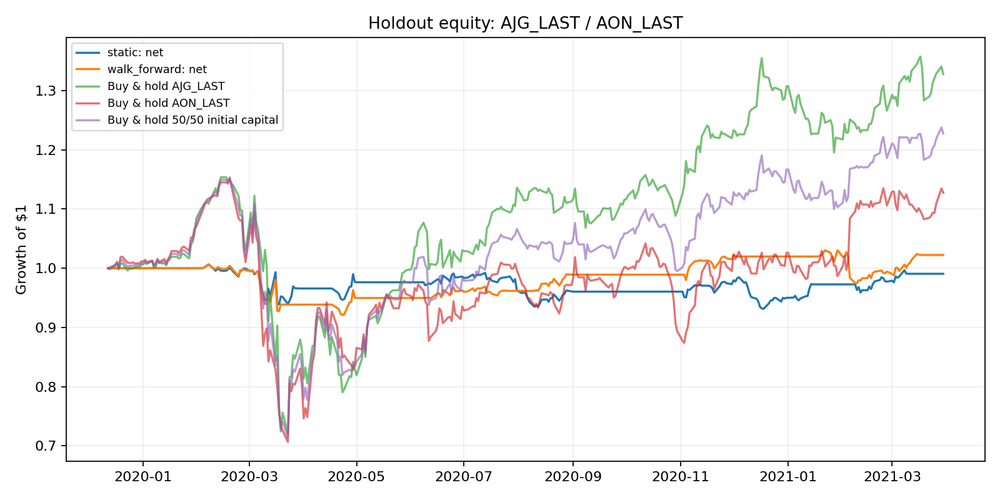

# Why Cointegrated Pairs Decay Out-of-Sample — a 226-Equity Study



A pairs-trading pipeline screens 226 equities for cointegration, picks the best in-sample pair, and trades it out-of-sample with transaction and borrow costs. The backtest edge is small and the story is not the return — it's the decay. Roll the hedge ratio and beta drifts from 0.85 to 1.55. Re-run the cointegration test on 126-day rolling windows and **26% of training windows reject the no-cointegration null; 0% of out-of-sample windows do.** The relationship I traded was already fragile in-sample at short horizons, and it did not survive contact with new data. I report the whole thing because the failure analysis is the deliverable.

*Extended from a research project (University of Illinois Urbana-Champaign, Department of Computer Science) and independently rebuilt. Authorship and scope notes at the bottom.*

## The pipeline

Built and unit-tested in Python for 226 equities × 846 days (2018-01-02 → 2021-03-30):

- **Cleaning** — error cells and nonpositive prices to missing, duplicate dates collapsed, thin columns dropped; no forward-fill.
- **Screening** (training data only) — log-return correlation ≥ 0.70 and ≥ 100 overlapping prices gate 144 candidate pairs; Engle–Granger with ADF residuals (`statsmodels.coint`, trend="c", autolag="AIC"); most negative t-stat among raw p < 0.05 wins. Benjamini–Hochberg runs as a diagnostic — **0 pairs survive it**, and I say so.
- **Signals** — 60-day lagged z-score (numerator at t−1, moments through t−2 — nothing from t leaks into the t→t+1 return), entry/exit/stop at 2.0/0.5/4.0, max 60-day holding.
- **Hedges** — static training beta vs walk-forward beta refit on a trailing 252-day window.
- **Costs** — 5 bps per absolute traded weight plus ~50 bps annualized borrow on short weight; the trade ledger reconciles to the equity curve to 1e−12.

Look-ahead bias is the bug that kills this kind of work, so the tests attack it directly: they corrupt future prices and assert today's signal doesn't move, and they verify that touching holdout data never changes training-period pair selection.

## Data — what runs and what doesn't

The main experiment uses a course price panel (226 cleaned equities, 846 days) that **cannot be redistributed**. Clone and run gives you the synthetic demo — a five-asset universe with one planted cointegrated pair — and the full test suite. Every number below is reproducible if you have the panel: set `AQTE_DATA_DIR` to the directory holding `SP500_Data_Sample_Prices.csv` and run `python run_main.py`.

```bash
pip install -r requirements.txt   # Python ≥ 3.11 (verified on 3.12 and 3.13)
python pipeline.py                # synthetic smoke test, writes demo_output/
python -m pytest                  # full suite, including the look-ahead regressions
```

## Stability first — the relationship was already decaying

Training beta is 0.8504. Out-of-sample, the trailing 252-day beta spans **0.814–1.553** (SD 0.193 — 3.5× the training window's 0.055), with maximum drift 0.70, or **83% of the training beta itself**. Rolling 126-day Engle–Granger tests on OOS prices: **214/214 windows fail to reject** no-cointegration at 5% (p from 0.11 to 0.97).

The control experiment matters as much. Same estimator, same window length, applied to the training period: **99/382 windows (25.9%) reject**. So 74% of *training* windows already fail to detect the relationship, even though the full-sample training test prints p = 0.0021. Short-window tests have little power on a selected pair. That cuts both ways: most of the OOS non-rejections are not proof of a structural break, and the 25.9% → 0% drop is an observation, not an identified cause. No defensible split between "low power" and "the relationship changed" comes out of these windows alone — which is why the beta drift is the stronger evidence.

## The P&L, after costs (338-day holdout)

| Hedge mode | Gross | After transactions | Net | Sharpe | Max drawdown |
| --- | --- | --- | --- | --- | --- |
| static | +0.25% | −0.75% | **−0.93%** | −0.02 | −7.43% |
| walk-forward | +3.55% | +2.40% | **+2.24%** | 0.22 | −8.48% |

Same period, for context (long-only, different risk): buy-and-hold AJG +32.77%, AON +12.73%, a 50/50 initial split +22.75%. A 2.24% net return against an 8.48% drawdown is a Sharpe of 0.22 — this is not a strategy anyone would book. The point of publishing it: costs took the walk-forward gross from +3.55% to +2.24%, and the hedge-ratio instability explains why the gross was fragile to begin with.



## New data, 2021–2026: the pair dies, the process survives its own test

I pulled a fresh window (2021-03-31 → 2026-10-28, 1,402 trading days) through the same cleaning rules and ran two checks:

| Check | Mode | Net | Sharpe |
| --- | --- | --- | --- |
| Original AJG/AON, fixed training α/β | static | −10.55% | −0.26 |
| Original AJG/AON, fixed training α/β | walk-forward | −4.33% | −0.06 |
| Re-screened on new training window (CMS/DTE) | static | +7.13% | 1.04 |
| Re-screened on new training window (CMS/DTE) | walk-forward | +2.00% | 0.29 |

The original pair loses money even before costs — the relationship is gone, not just expensive to trade. The same selection procedure, rerun from scratch on the new window, finds a different pair with a modest positive net. That's the honest headline: **the specific edge decays; the process doesn't collapse.** One new pair on one new split is still n = 1. LSEG closes are not redistributable — the repo ships the fetch script and SHA256 manifest ([out_of_time/](out_of_time/)), not the data.

## What I take from this

In-sample cointegration is a statement about a sample, not about a market. The things that actually predicted failure were visible before the holdout: a hedge ratio that won't sit still, and a significance that doesn't survive short windows. Next iteration is multi-pair portfolios with FDR control at selection time — one pair, one split can't carry a profitability claim, and I'm not going to pretend otherwise.

## Provenance and authorship

Extended from a research project (University of Illinois Urbana-Champaign, Department of Computer Science) and independently rebuilt: the look-ahead regression tests, the cost decomposition, the BH diagnostic, the rolling-stability controls, and the 2021–2026 revalidation are my additions on top of the original pairs-trading pipeline. The design of each validation, and the interpretation of every number above, are mine; parts of the implementation were drafted with AI assistance and reviewed line by line. Tests pin the quoted numbers where the data allows.

## Limitations

One train/holdout split and one selected pair cannot establish profitability that generalizes — multiple pair tests create selection bias, and no pair survives the BH diagnostic. The universe is not dividend-adjusted total returns and can contain survivorship bias; the source has missing and equal adjacent prices (a flag, not proof of stale quotes). Rolling alpha/beta means each historical spread uses its own fitted hedge ratio, so the rolling z-score moments mix residuals defined with different betas — measured and disclosed, not silently redefined. Borrow is a constant trading-day approximation without locate constraints, recalls, or fees; execution is daily close with linear costs. Weights are gross-normalized beta weights, not generally dollar-neutral. The final price has no forward return; an open last trade is marked open, not force-liquidated. Short-window test frequencies are overlapping observations on a selected pair — neither independent trials nor direct power estimates. The 2021–2026 check adds one out-of-time window and one re-screened pair; it does not rescue the original pair and does not prove the process generalizes.
